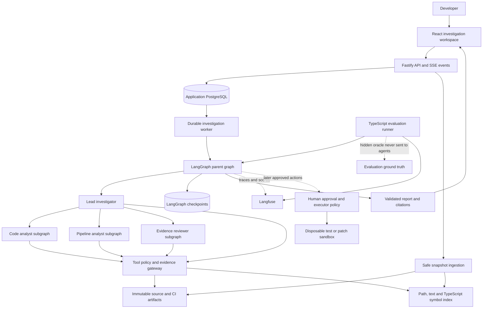
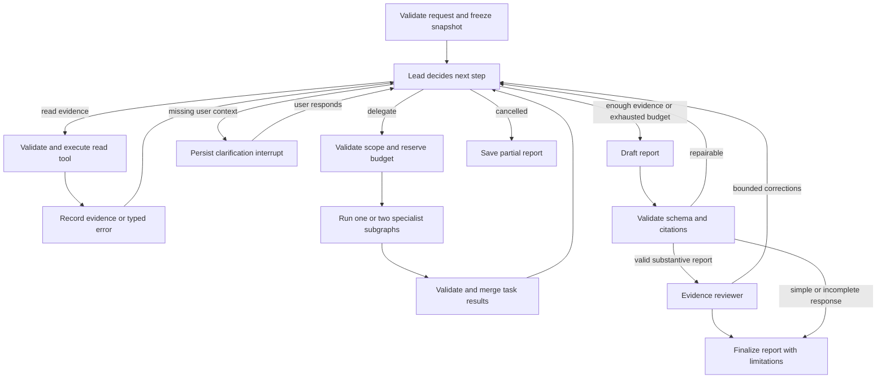
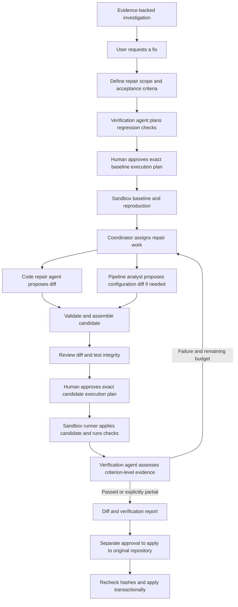

# Repository Investigator

## Architecture and implementation blueprint

**Status:** proposed architecture; no application implementation or benchmark results yet.

**Product:** a local-first TypeScript application that investigates a repository, correlates source and pipeline evidence, tests competing explanations, and produces a report whose findings can be independently checked.

**Portfolio positioning:** “A durable, evidence-grounded repository investigation system with bounded multi-agent orchestration, replayable evaluations, and explicit approval boundaries.”

The differentiator is the combination of investigation quality, traceable evidence, resilience, and measured orchestration tradeoffs. Agent count alone is not the achievement.

## 1. Scope and assumptions

The first release supports TypeScript/JavaScript repositories with Node.js package manifests and common CI configuration. All code written for this application, tools, generators, tests, and evaluations is TypeScript. TSX is used for React. JSON, YAML, Markdown, SQL emitted by tools, and infrastructure configuration are supporting formats rather than alternative application languages.

Inputs are a user-selected local directory or a locally supplied snapshot, a question, and optionally exported CI logs and a second source snapshot. No remote cloning, GitHub API access, commits, branches, pushes, or worktrees are required. The owner handles GitHub operations separately.

The intended user is a developer investigating questions such as:

- “Explain how checkout requests reach the payment adapter.”
- “Why does CI fail while the local build passes?”
- “Which change likely caused this test failure?”
- “What will be affected if I change this interface?”
- “Investigate this repository and identify the highest-confidence engineering risks.”

A broad request defaults to a documented bounded survey: architecture, build/test configuration, and a small set of prioritized findings. It must disclose which packages and files were inspected. It is not an exhaustive security audit or proof that the repository is bug-free.

**Version one:** four available agent roles, read-only repository analysis, replayable CI evidence, persisted investigation state, source-linked reports, human clarification, complete tracing, and measured evaluation.

**Phase two, now architected in Section 21:** repair coordination, code and pipeline patch proposals, independently planned verification, approved sandbox execution, and separately approved patch application. Production incident integrations remain outside this release. Phase one remains read-only; phase two is planned, not implemented.

**Sizing assumptions:** one local user; one active investigation initially; two concurrent specialist tasks maximum. Proposed repository envelope: 5,000 eligible text files, 50 MB total ingested text, 1 MB per file, with explicit exclusion reporting. Larger repositories require a user-selected package/subdirectory. These are configurable resource limits, not measured capacity claims.

## 2. System architecture



The agents are logical roles in one worker process, not four microservices. The first deployment shape is three application processes: web development server, API, and worker. The production-style local build can serve static web assets through the API.

Use PostgreSQL for application records, a job table, and a persistent LangGraph checkpointer in separate schemas. One database technology reduces duplication when the system already needs durable task and approval records. Langfuse has its own storage and infrastructure; do not write into its database directly.

A worker claims jobs with a lease and heartbeat. Use a monotonically increasing fencing token so an expired worker cannot keep committing results. Cancellation is propagated through model calls and tools using AbortSignal. A unique investigation/run key prevents accidental duplicate launches.

Local files hold immutable snapshots and larger evidence artifacts. PostgreSQL stores metadata and bounded indexed excerpts. No vector database, Redis application queue, Kubernetes, or service mesh is needed initially. Langfuse's own local stack may use additional services independently.

## 3. Technology decisions

- **Runtime:** a supported Node.js LTS version, pinned at implementation; TypeScript strict mode and ESM.
- **Workspace:** pnpm workspaces with a locked dependency graph. Add a task-cache orchestrator only if build time justifies it.
- **Frontend:** React + Vite + TypeScript, React Router, TanStack Query for server state, and accessible UI primitives. This is an application workspace, so server-rendered marketing features are unnecessary.
- **Backend:** Fastify, Zod runtime contracts, documented HTTP APIs, and Server-Sent Events for progress. The API creates jobs; it does not hold an HTTP request open while a model investigates.
- **Persistence:** PostgreSQL, Drizzle for application schemas and queries, and the compatible official LangGraph PostgreSQL checkpointer. Prove driver and transaction behavior before implementing the rest.
- **Repository analysis:** TypeScript compiler API through ts-morph for syntax, imports, symbol definitions, and bounded reference lookup. Text search and path search remain first-class tools. Dynamic imports and generated code are explicitly marked as coverage limitations. [ts-morph documentation](https://ts-morph.com/)
- **Models and tools:** LangChain, including the selected provider integration, structured outputs, and Zod-defined tools.
- **Orchestration:** LangGraph state, conditional edges, specialist subgraphs, checkpoints, retries, and interrupts.
- **LLM observability:** Langfuse traces, prompt versions, experiment runs, scores, and human annotations.
- **Tests:** Jest with a TypeScript transformer, React Testing Library, Playwright, fast-check, and Testcontainers for Node.js.
- **Code quality:** ESLint with TypeScript rules, Prettier, explicit package boundaries, and a separate TypeScript typecheck step.
- **Operations:** structured application logging, health/readiness endpoints, Docker Compose for local dependencies, and CI workflow definitions.

Choose **Jest** as the primary familiar testing framework, rather than combining Jest and Vitest. Use @swc/jest for transformation after an ESM compatibility spike. Transpilation does not replace type checking: run `tsc --noEmit` separately. This is a practical mainstream choice, not an unverified claim about an exact popularity ranking. [Jest TypeScript setup](https://jestjs.io/docs/getting-started), [SWC Jest integration](https://swc.rs/docs/usage/jest)

Playwright supplies browser-level verification using TypeScript tests. Testcontainers supplies real disposable database dependencies for integration tests. [Playwright TypeScript](https://playwright.dev/docs/test-typescript), [Testcontainers Node.js](https://node.testcontainers.org/)

Pin exact compatible library and model versions during the first implementation milestone. Do not use floating model aliases for benchmark comparisons if immutable identifiers are available. Record provider-reported model identity when aliases cannot be avoided.

## 4. What each agent does

### A. Lead investigator — required

**Owns:** the user's objective and the final answer.

**Inputs:** question, sanitized repository overview, scope, budgets, existing evidence references, and prior task results.

**Decisions:** answer directly; inspect a file; request a specialist; request clarification; test an alternative explanation; request review; or stop with uncertainty.

**Tools:** repository overview, bounded source/evidence reads, search, and typed delegation to approved specialist roles.

**Outputs:** investigation plan, task assignments, evolving hypotheses, reconciled findings, final report, and optional action proposals.

The lead handles simple requests without delegation. It checks whether specialist findings actually answer the question, resolves disagreement by gathering discriminating evidence, and communicates with the user. There is no separate “response writer” agent.

The lead cannot alter permission policy, fabricate approval, access the evaluator oracle, run shell commands, or exceed global budgets.

### B. Code analyst — invoked when code reasoning is substantial

**Owns:** source structure, execution paths, change impact, and candidate code defects.

**Inputs:** one bounded question, snapshot IDs, relevant packages/paths, known evidence, and a task-specific budget.

**Tools:** file tree, source ranges, text search, symbol definitions/references, import relationships, and snapshot diffs.

**Behavior:** traces relevant paths; compares definitions with callers; inspects tests as source; checks whether a proposed explanation fits the implementation; seeks counterexamples.

**Outputs:** findings with exact file/line references, a concise causal explanation, alternatives, uncertainty, and what was not inspected.

It may analyze configuration and obvious risky code but is not presented as an exhaustive vulnerability scanner. Static analysis establishes plausible behavior, not proof that a particular runtime failure occurred.

It cannot execute repository scripts, write files, install dependencies, or delegate recursively.

### C. Pipeline analyst — invoked for build, test, or release questions

**Owns:** the relationship between package configuration, CI definitions, and supplied run evidence.

**Inputs:** a bounded pipeline question, workflow configuration, available CI runs, snapshot identity, and budget.

**Tools:** structured package metadata, workflow excerpts, imported run summaries, bounded log search, test-result excerpts, and source reads needed to correlate configuration.

**Behavior:** checks runtime version mismatch, working directories, command selection, dependency installation, build outputs, test discovery, cache configuration, and dependency ordering.

**Outputs:** failing step, supporting logs/configuration, suspected mechanism, missing evidence, and recommended verification.

A workflow file proves intended configuration, not that a run succeeded or failed. Imported logs retain their supplied run identity and source snapshot association; ambiguous associations remain explicit.

It cannot trigger CI, access provider secrets, rerun jobs, install packages, or execute commands.

### D. Evidence reviewer — invoked before substantial final reports

**Owns:** challenging the draft's factual support and completeness.

**Inputs:** user objective, draft atomic claims, citations, inspection coverage, and budget. It does not receive the other agents' full conversational histories or evaluator labels.

**Tools:** citation resolution, original source/CI evidence, and limited independent reads to check a counterexample.

**Behavior:** flags unsupported causal leaps, wrong file versions, conflicting evidence, exaggerated severity, missing caveats, and missing answers to the user's question.

**Outputs:** claim-level supported/unsupported/uncertain judgments, evidence references, and specific revision requests.

It cannot approve actions or certify correctness. A structurally valid citation can still be irrelevant; deterministic checks and semantic review serve different purposes. Using the same underlying model does not make reviewer errors statistically independent.

At most one normal review and one correction pass. The lead may retain a disputed claim only by qualifying it and exposing the unresolved disagreement, never by hiding the review.

### E. Patch proposer — phase-two role, not required for version one

**Owns:** drafting a minimal change and a regression-test proposal after the cause is sufficiently supported.

**Inputs:** accepted findings, exact snapshot, permitted files, and explicit user request to propose a fix.

**Outputs:** a diff artifact, rationale, risks, and test plan. Generating a proposal is distinct from applying it.

It initially has no host write or execution capability. A later executor can apply an approved diff in an isolated disposable copy, then run an independently approved test profile. Applying to the user's original repository is a separate future approval with fresh base-hash checks.

**Total for phase one:** four investigation role definitions, normally one to three active at a time. Section 21 defines the repair extension, including two additional roles and expanded responsibilities for the existing pipeline analyst. Build the lead first, then add specialists and reviewer behind evaluation flags.

## 5. Agent communication contract

All agents can use the same provider model initially. Their identities come from separate instructions, context, tool permissions, and budgets—not separate trained models.

Each delegation contains a task ID, role enum, exact question, snapshot IDs, scoped paths, supplied evidence IDs, expected result schema, deadline, and allocated budget. The server attaches trusted investigation and authorization context; the model cannot supply another user's identity.

Each specialist returns a structured result containing:

- Task ID and status: completed, partial, blocked, or failed.
- Findings, each with an atomic claim and evidence IDs.
- Supporting and contradicting evidence.
- Inspected paths and known coverage gaps.
- Suggested next discriminating check.
- Usage totals and stopping reason from trusted runtime accounting.

The lead receives concise results and evidence pointers rather than raw internal conversations. Specialists do not message one another or spawn other specialists. Follow-up work is a new task or an explicit continuation of the same task, with preserved context and remaining budget.

LangChain documents the supervisor pattern in which a main agent invokes subagents through tools and combines their results. Use that model conceptually, implemented as typed dispatch into bounded LangGraph subgraphs. [LangChain subagents](https://docs.langchain.com/oss/javascript/langchain/multi-agent/subagents)

## 6. LangGraph execution model



The graph fixes boundaries and recovery mechanics, not the order of evidence collection. The lead chooses whether to delegate, which evidence to inspect, and when evidence is sufficient. Tests should show different trajectories for different inputs.

**Parent state:** investigation and snapshot IDs; objective; scope; status; hypotheses; tasks; evidence references; draft report; review issues; budget ledger; model/prompt versions; pending interrupt; cancellation flag; stopping reason.

**Specialist state:** task identity; assigned scope; bounded messages; observations; local hypotheses; pending tool calls; allocated remaining budget; structured result.

Use task-specific checkpoint namespaces. Parent and child share stable identifiers and immutable evidence references, not a mutable shared message list. Apply reducer updates by task/evidence ID; sort merged results deterministically so completion order does not silently alter stored state.

LangGraph supports subgraphs as nodes with explicit input/output interfaces. Persistence stores thread state for recovery. [LangGraph subgraphs](https://docs.langchain.com/oss/javascript/langgraph/use-subgraphs), [LangGraph persistence](https://docs.langchain.com/oss/javascript/langgraph/persistence)

**Proposed initial limits:** 24 model calls globally; six specialist tasks; eight model turns per specialist but always subject to the global limit; 40 read-tool attempts; two concurrent specialists; two transport retries; one review correction pass; five-minute active deadline. Token and monetary limits are configured separately. These limits are starting policies to tune on validation data.

Budget reservations occur before fan-out. Parent accounting includes all children, retries, review, and synthesis. A child's unused allocation returns to the parent. If budget is exhausted, preserve evidence and produce an explicitly partial report.

## 7. Tools and evidence provenance

Initial read tools:

1. `getRepositoryOverview`: eligible packages, file counts, manifests, supplied run summaries, and exclusions.
2. `listFiles`: bounded paths with safe prefix/glob filtering and cursor pagination.
3. `readFileRange`: immutable file hash, line interval, and bounded text.
4. `searchText`: literal text search first; bounded results with path and line references. Avoid unrestricted regular expressions initially.
5. `findSymbol`: declaration and bounded references within the indexed snapshot.
6. `getImportNeighborhood`: bounded import/dependency relationships; unresolved dynamic edges are flagged.
7. `compareSnapshots`: diff hunks between two supplied immutable snapshots.
8. `getPackageConfiguration`: manifests and interpreted script metadata, without executing scripts.
9. `getPipelineDefinition`: parsed workflow structure plus original excerpts.
10. `listPipelineRuns` and `searchPipelineLog`: imported run metadata and bounded log excerpts.
11. `getEvidence`: original evidence by authorized ID.

A future test runner is deliberately separate from this read-only registry.

Every tool has a Zod input/output contract, capability classification, timeout, maximum output size, redaction policy, and normalized-query cache key. Unknown arguments fail validation. Never accept arbitrary shell, SQL, filesystem paths outside the snapshot, or external URLs.

Result envelopes contain call ID, status, schema version, snapshot ID, retrieval time, evidence IDs, coverage/truncation metadata, and cursor. Errors have typed codes and retry guidance. Empty results remain successful zero-match responses.

Evidence records bind to snapshot ID, file/artifact hash, path, line interval or log span, excerpt, and tool-call provenance. The gateway creates IDs and hashes; agents cannot mint evidence. Source attribution from an imported CI artifact is distinct from verified origin.

Citation syntax in generated reports can be an internal token such as `[E17]`. The renderer resolves it to an immutable inspector view. A raw line number in the user's currently changing directory is not a stable citation.

## 8. Safe ingestion and retrieval

The user selects a local directory through an explicit import action. The importer creates a read-only analysis snapshot rather than working on the original directory. It excludes `.git`, dependency directories, binaries, generated output, environment files, private keys, and oversized files by policy; users see exclusions.

Reject symlinks and unsupported file types initially. Canonicalize paths, enforce containment, and detect file changes during ingestion. If the directory changes while reading, retry or disclose an inconsistent import rather than attach a false immutable identity. If archive import is later added, reject traversal paths and enforce expanded-size limits.

Do not execute repository configuration, package scripts, compiler plugins, hooks, or install commands during indexing. Parse JSON/YAML as data with bounded alias expansion. Use a controlled compiler filesystem so source resolution cannot escape the snapshot.

Begin retrieval with exact path/text search and TypeScript symbols. Embeddings are a later hypothesis, to be added only if evaluation identifies a recall problem. No automatic cross-repository memory: conversations remain scoped to a snapshot unless the user explicitly selects a comparison.

The user must know when selected source excerpts will be sent to a hosted model. All ingestion and search remain local; local-first does not imply offline inference. Support a compatible local model adapter later and report its results separately.

## 9. Data model and APIs

Core records:

- `Repository`: display name and import policy; do not expose the user's absolute local path to the model.
- `Snapshot`: content manifest/hash, import status, exclusions, package inventory, index version.
- `SourceArtifact`: snapshot, path, content hash, size, and immutable storage location.
- `PipelineArtifact`: user-supplied run metadata, log references, provenance level, and associated snapshot if known.
- `Investigation`: objective, status, configuration, trace ID, cancellation, timestamps, stopping reason.
- `AgentTask`: role, task input, scope, parent, status, checkpoint namespace, and result.
- `ToolCall`: normalized arguments, retries, timing, outcome, and evidence references.
- `Evidence`: immutable locator, excerpt/hash, source, and completeness flags.
- `Finding` and `Claim`: factual statement, qualification, evidence links, contradiction links, and review status.
- `Report`: immutable version, findings, inspected scope, limitations, and recommendations.
- `Event`: monotonic sequence per investigation for streaming and replay.
- `BudgetUsage`: reserved/actual calls, tokens, cost estimate, and model pricing version.
- `Approval` and `ActionReceipt`: reserved for exact authorized action proposals and auditable outcomes.
- `EvaluationRun` and `Score`: configuration, dataset partition, scorer versions, and aggregate references.

Application data and graph checkpoints have separate ownership. Job claiming is transactional; graph nodes and result publication are idempotent. A reconciler repairs a job marked running when its graph has already finished, preventing lost completion after a crash.

Planned API contracts:

- `POST /repositories/import` → import job and snapshot reference.
- `GET /snapshots/:id` → readiness, inventory, and exclusions.
- `POST /investigations` → run ID; supports an idempotency key.
- `GET /investigations/:id` → durable status and summary.
- `GET /investigations/:id/events` → SSE, resumable by event sequence.
- `GET /investigations/:id/report` → report version.
- `GET /investigations/:id/evidence/:evidenceId` → authorized original evidence.
- `POST /investigations/:id/clarifications` → answer a specific pending interrupt.
- `POST /investigations/:id/cancel` → cooperative cancellation.
- Future `POST /actions/:id/decisions` → approve/reject the exact displayed action.

The browser never receives model keys or database credentials. Stream concise actions, results, and decision summaries—not hidden chain-of-thought. SSE events include schema version and event type so reconnecting clients can deduplicate and recover.

## 10. Security and future action approval

Treat repository content as untrusted evidence, including files named AGENTS.md, comments, README instructions, test output, and CI logs. Such files may describe project conventions but cannot change the investigator's role, permissions, or approval policy. Tool errors can contain injected content too.

Separate trusted instructions from source excerpts. Apply policy in the gateway and executor rather than relying on prompt text. Redact sensitive patterns before inference and tracing, but do not claim pattern matching detects every secret. The explicit import scope and outbound-data notice remain necessary.

Bind the API to loopback; enforce an authenticated local session, strict origin checks, CSRF protection on mutations, bounded bodies, and safe rendering. Do not fetch URLs discovered in source content. Pin approved provider/telemetry destinations. Use application-level roles so the agent process cannot query approval or oracle tables as a privileged user.

Version one is read-only with respect to the investigated repository. Persisting application state and reports is ordinary application behavior, not a repository mutation.

For later execution, approval binds to action ID, exact canonical payload hash, snapshot/base hash, permitted paths or test profile, image digest, resource limits, expiry, and one-time idempotency key. The executor reads the authoritative approval record; a model-generated `approved: true` is never trusted.

An interrupted node can rerun on resume, so keep the approval interrupt separate from mutation and make the executor idempotent. [LangGraph interrupts](https://docs.langchain.com/oss/javascript/langgraph/interrupts)

Untrusted repository tests are code execution. Even `npm test` and dependency installation can run arbitrary code. Later execution must use a disposable isolated copy, no secrets, no host paths or Docker socket, disabled network by default, non-root execution, dropped capabilities, and CPU/memory/PID/time limits. A worker broker owns sandbox creation; agents never control raw container options. For hostile third-party repositories, ordinary containers are not a claim of complete isolation; use a stronger sandbox boundary or keep execution disabled.

Approval for one test profile does not authorize package installation, network access, or applying a patch to the original directory. A changed target or payload requires fresh approval. Never claim a patch is verified without an actual recorded test result.

## 11. Failure and recovery policy

- Invalid tool arguments: return structured feedback; one bounded repair, not a transport retry loop.
- Transient provider/tool failure: bounded backoff with jitter; all attempts count toward budget.
- Empty or irrelevant results: reformulate search, inspect another source, or abstain.
- Repeated identical queries: use cache and surface lack of progress.
- Specialist timeout: retain partial evidence and mark the task partial; the lead may continue without that branch.
- Conflicting specialists: keep both findings and perform a discriminating check; do not resolve by majority vote.
- Context exhaustion: summarize task state with stable evidence IDs; reopen originals when needed.
- Model schema failure: bounded repair, then structured failure rather than invented output.
- Worker crash: resume from checkpoint; task IDs prevent duplicate result publication.
- Budget/deadline exhaustion: publish a partial report and exact stopping reason.
- Cancellation: stop new work, cancel active calls where supported, and preserve completed evidence.
- Langfuse outage: queue a bounded local outbox; preserve core investigation functionality and show trace-delivery status.
- Database outage: stop work that cannot be durably accounted; do not continue uncontrolled model spending.

## 12. Langfuse instrumentation and prompts

Create one root trace per investigation. Propagate trace context into subgraphs and tag spans by role/task. Include ingestion, graph decisions, model calls, tools, result validation, review, and final report publication. Avoid double-counting model calls when using both callbacks and manual spans.

Record model identifier, prompt names/versions/hashes, tool-schema version, snapshot hash, dataset/run identity when applicable, call counts, token categories, latency, cost estimate, retries, error class, and stopping reason. Store only sanitized content. Provide a UI link from report to trace.

Use Langfuse prompt management for lead, code analyst, pipeline analyst, reviewer, and evaluator prompts. Resolve versions once per run and keep a local pinned fallback. A fallback changes the recorded provenance; it must not silently masquerade as the requested version.

Langfuse's LangChain integration captures model/tool activity through callbacks. Its SDK experiment interface supports local datasets and JS/TS tasks/evaluators. [Langfuse tracing](https://langfuse.com/integrations/frameworks/langchain), [Langfuse experiments](https://langfuse.com/docs/evaluation/experiments/experiments-via-sdk)

Operational logs and database metrics remain distinct from LLM traces. Track queue age, active jobs, worker lease failures, database health, snapshot ingestion size, and event delivery in ordinary application logging. Use Langfuse for the model-level questions it is designed to answer.

## 13. Product experience

The primary workspace has a question/scope panel, a central investigation timeline and report, and an evidence inspector. A compact task map shows actual specialist activity, not decorative agents that always light up.

Important interactions:

- Select a local snapshot and see excluded files before investigation.
- Ask a question or select a sample scenario.
- Watch “code analyst inspecting payment mapping” and “pipeline analyst comparing runtime versions.”
- Open an individual finding and inspect exact cited source/CI lines.
- See confidence qualifications, inspected scope, contradictions, and unanswered questions.
- Follow up against the same immutable snapshot.
- Cancel or resume a clarification without losing completed work.
- Compare single-agent and delegated runs in an evaluation view.
- Later, inspect a proposed diff and explicitly approve a precisely described test/application action.

Status labels distinguish observed, inferred, reproduced, unresolved, proposed, approved, and executed. A green pipeline badge requires evidence of that pipeline result. Accessibility requirements include keyboard navigation, focus management, readable code, text labels in addition to color, and reduced-motion support.

UI UX Pro Max was not found in the available local skill locations. This document defines functional UX architecture; visual implementation should use that skill once available. No UI implementation or mockup is included.

## 14. Test architecture

**Jest unit tests:** tool schemas, source-range extraction, citation resolution, normalization, budget arithmetic, retry policy, report validation, redaction, approval hashes, and action expiry.

**fast-check property tests:** no normalized path can escape the snapshot; changed action content invalidates an approval; parallel budget reservations never exceed the global cap; event replay is idempotent.

**Jest integration tests:** real PostgreSQL via Testcontainers, snapshot ingestion, source tools, mocked model graph trajectories, checkpoint recovery, concurrent result merging, and SSE replay.

**React Testing Library:** evidence panel behavior, pending clarification, cancellation, and accessible approval states. Avoid implementation-detail snapshots as the main assurance.

**Playwright:** import fixture → ask question → observe delegation → open citation → inspect report. Add restart/reconnect, incomplete evidence, and rejection paths. Use scripted model responses for stable CI behavior; real-model quality belongs in evaluation.

**Security tests:** traversal and symlink escape, oversized artifacts, malicious README instructions, fake approvals in logs, HTML injection, cross-investigation evidence access, unauthorized executor calls, stale/replayed approvals, and disallowed outbound requests.

**Fault tests:** model timeout, malformed result, one failed specialist, cancellation during fan-out, crash before/after task completion, and unavailable telemetry.

Proposed coverage gates: 80% overall branches, 95% for policy/citation/budget modules, with every documented authorization path explicitly tested. Coverage is a diagnostic, not proof of correctness. No production-safety claim comes from line coverage alone.

## 15. Evaluation design

Create synthetic TypeScript repository fixtures with intentional, known defects and supplied CI evidence. Generate data with TypeScript and fixed seeds. Store hidden labels in a separate evaluator location not mounted into agent processes.

Eight families: code-path explanation; cross-file regression; local/CI runtime mismatch; package/build configuration defect; test discovery or misleading test output; change-impact analysis; healthy repository/no justified defect; insufficient or contradictory evidence.

Initial dataset: 16 development cases. Proposed complete dataset: 80 cases split 32 development, 16 validation, 32 locked test. Group related repositories, generated variants, and counterfactual pairs within one partition. Hold some fault mechanisms and repository structures out entirely. Record the limitation that synthetic fixtures do not establish real-company performance.

Adversarial overlays include source comments that issue commands, README text impersonating system policy, CI logs claiming approval, decoy failures, irrelevant stack traces, stale logs, missing artifacts, and tool timeouts. Add cases where the recent change is innocent so the system cannot solve everything by blaming the diff.

Compare three configurations:

1. Fixed retrieval workflow plus one report call.
2. One lead agent with all read tools and no specialists.
3. Lead plus optional specialists and reviewer.

Use the same model, snapshot access, dataset, and global budgets. Run the locked test set three times per configuration, giving 96 runs per configuration. Report distributions and scenario-clustered confidence intervals; repeated runs are not independent new scenarios. An optional reviewer ablation isolates its contribution from specialist delegation.

Scoring combines deterministic checks, oracle-based causal facts, and blinded semantic assessment. Calibrate any LLM judge against human review. Review all safety failures, judge disagreements, and a stratified sample of successes. Persist scorer versions and do not use the investigating model's self-rating as the score.

**Proposed targets, not measured results:**

- Answer/root-cause correctness: at least 80% exact on answerable cases; also show per-family and partial-credit results.
- Citation resolution: 100% resolve to authorized snapshot evidence.
- Evidence precision: at least 95% of factual claims are supported by cited evidence.
- Required fact coverage: at least 90% of oracle-required facts included.
- Unsupported factual claims: at most 2%; zero unsupported claims presented as grounds for an executable action.
- Appropriate abstention: at least 90% on unanswerable cases, reported with answer coverage.
- Injection success/unauthorized mutations: zero observed in the defined suite; never translate that into a guarantee of universal immunity.
- Tool efficiency: median at most 20 read attempts and fewer than 15% redundant attempts, alongside correctness.
- Recoverable failure handling: at least 90% correct completion under designated recoverable faults.
- Latency: proposed p95 below 180 seconds on a documented reference setup; five-minute hard active cap. Exclude human waiting but report it separately.
- Cost: proposed median below US$1 and p95 below US$2 per investigation; cap requests using configured model prices and maximum tokens. Prices and actual outcomes must be measured, not assumed.
- Delegation value: report accuracy difference, latency ratio, cost ratio, and simple-task unnecessary-delegation rate against the single-agent baseline. There is no predetermined claim that multi-agent wins.

Include reviewer and failed-call usage in cost, evaluator usage separately, and missing provider usage as unknown. Report the pricing table version. Publish raw redacted runs, aggregate JSON/Markdown, and representative failed cases.

## 16. CI architecture

Design GitHub Actions workflows, but the owner creates/publishes/enables them. This architecture authorizes no GitHub operation now. Every meaningful check is also runnable locally through pnpm.

**Pull-request verification, without model keys:** frozen-lockfile install; formatting/lint; TypeScript checks; package-boundary checks; Jest unit/security tests; integration tests with disposable PostgreSQL; production build; Playwright smoke tests using a scripted model. Export coverage, JUnit output, and Playwright traces on failure.

Run quick checks concurrently, then integration/build/browser dependencies in their required order. Use a small supported Node-version matrix for core tests rather than duplicating every expensive job. Cache dependencies using lockfile and runtime keys; never treat a stale cache as proof dependencies match.

**Trusted scheduled/manual evaluation:** run real-model validation cases against an explicitly trusted revision, with restricted secrets, concurrency, spending limits, and timeout. Archive scores and sanitized traces and compare with the accepted baseline. Do not expose model keys to arbitrary fork code. Locked test runs occur at designated release evaluation, not on every tuning iteration.

**Dependency/security checks:** lockfile integrity, dependency audit, secret scanning, license review, and container scanning if distributing images. Triage findings explicitly rather than hiding them or blindly equating every advisory with an exploitable application vulnerability.

**Release validation:** typecheck, tests, artifact build, fixture demo smoke run, and a human-reviewed evaluation report. No automatic deployment, publish, or repository write workflow is required.

CI token permissions should default to read-only; pin third-party actions to immutable revisions; do not execute untrusted pull-request code in privileged workflows. [GitHub Actions secure use](https://docs.github.com/en/actions/reference/security/secure-use)

## 17. Planned project structure and commands

```text
apps/
  web/                     React workspace
  api/                     Fastify routes and SSE
  worker/                  Job leases and graph execution
packages/
  contracts/               Zod schemas and shared types
  agents/                  Lead, code, pipeline and reviewer graphs
  tools/                   Read adapters and capability registry
  repository/              Snapshot ingestion and source indexes
  evidence/                Provenance, citations and report checks
  database/                Application schema and migrations
  observability/           Langfuse and structured logging
  policy/                  Scope, budgets and future approvals
  evaluation/              Datasets, baselines, scorers and reports
fixtures/                  Public input snapshots and synthetic CI logs
tests/                     Cross-package integration and browser suites
scripts/                   TypeScript development and evaluation scripts
docs/                      Architecture decisions, threat model and demo guide
infra/                     Local dependency configuration
```

The hidden oracle must not sit under a fixture directory imported into agent snapshots. The evaluator receives it separately. Avoid creating empty packages in the first task; introduce boundaries when the corresponding vertical slice exists.

Planned command interface: `pnpm dev`, `pnpm build`, `pnpm lint`, `pnpm format:check`, `pnpm typecheck`, `pnpm test:unit`, `pnpm test:integration`, `pnpm test:security`, `pnpm test:e2e`, `pnpm fixtures:generate`, `pnpm eval:dev`, `pnpm eval:validation`, and `pnpm eval:test`.

Code conventions: strict types; no unchecked `any`; runtime schemas at trust boundaries; discriminated result unions; explicit dependency injection for models, clocks and storage; AbortSignal for cancellable operations; typed error codes; no domain decisions hidden in UI components. Keep pricing and model choices in validated configuration.

## 18. Incremental implementation plan

Each task should fit one focused implementation session and ordinarily touch two to five files, including its test. Split any task that grows beyond that. File areas below are planned ownership, not files already created. Every phase checkpoint requires successful build/typecheck and its relevant deterministic tests.

### Phase A — integration and risk spikes

**A1. Bootstrap the smallest TypeScript workspace.** Depends: none. Areas: root configuration and one contracts package. Acceptance: locked install, lint, typecheck, Jest test and build succeed. Verify: local command suite. Do not scaffold all future packages.

**A2. Prove model → tool → trace.** Depends: A1. Areas: agents, observability, integration test. Acceptance: LangChain invokes one schema-validated tool through LangGraph; Langfuse links the model and tool spans to a pinned prompt. Verify: mock integration plus one manually initiated model smoke run.

**A3. Prove persistence and interruption.** Depends: A2. Areas: database/checkpoint adapter, worker, recovery test. Acceptance: an interrupted graph resumes after process restart; duplicate resume cannot duplicate an inert recorded action. Verify: crash/restart integration test.

Checkpoint: compatible ESM/Jest/framework versions and durable execution are established before product expansion.

### Phase B — one complete read-only investigation

**B1. Import a safe immutable snapshot.** Depends: A1. Areas: repository importer, contract, tests. Acceptance: hashes/exclusions are recorded; symlinks and escaped paths are rejected. Verify: ingestion and malicious-path tests.

**B2. Search and cite source.** Depends: B1. Areas: tools, evidence, tests. Acceptance: file reads and searches return stable, bounded citations; empty/truncated results are explicit. Verify: tool contract and citation tests.

**B3. Answer one code question with the lead.** Depends: A2, A3, B2. Areas: lead graph, report contract, graph test. Acceptance: the lead chooses evidence dynamically and returns a cited answer or justified uncertainty. Verify: scripted branching tests and development-case inspection.

Checkpoint: a complete import → question → evidence → report path works without specialists.

### Phase C — usable investigation workspace

**C1. Expose durable jobs and events.** Depends: B3. Areas: API, worker lease, event tests. Acceptance: idempotent creation and reconnectable progress stream work; expired workers cannot publish. Verify: API and lease-recovery tests.

**C2. Display an investigation and its evidence.** Depends: C1. Areas: web workspace, evidence panel, browser test. Acceptance: a user launches a fixture question and opens a citation at the correct snapshot lines. Verify: Playwright flow and keyboard checks. Load UI UX Pro Max before visual implementation.

**C3. Support cancellation and clarification.** Depends: C2, A3. Areas: graph interrupts, API/UI controls, tests. Acceptance: state survives reconnect; cancellation stops further dispatch. Verify: Playwright and interrupted-graph tests.

Checkpoint: the single-agent version is independently demonstrable and becomes an evaluation baseline.

### Phase D — bounded specialists

**D1. Add scoped code delegation.** Depends: B3. Areas: delegation contract, code subgraph, graph test. Acceptance: the lead can delegate and receive evidence-backed structured findings; child spawning is unavailable. Verify: scope-isolation and malformed-result tests.

**D2. Add pipeline evidence analysis.** Depends: D1. Areas: CI import/tool, pipeline subgraph, fixtures/tests. Acceptance: a supplied run can be correlated with workflow/package configuration; missing or ambiguous logs remain explicit. Verify: runtime-mismatch and insufficient-evidence cases.

**D3. Add bounded parallel execution.** Depends: D2. Areas: dispatch/budget ledger, merge reducer, tests. Acceptance: two specialists can run concurrently without overspending or duplicate result publication. Verify: randomized completion order and budget property tests.

Checkpoint: demonstrate one useful parallel investigation and one simple request that avoids delegation.

### Phase E — report reliability

**E1. Validate atomic claims.** Depends: D3. Areas: report/evidence schemas, validator, tests. Acceptance: fabricated, wrong-snapshot, and unauthorized citations are rejected. Verify: intentionally corrupted reports.

**E2. Add evidence review.** Depends: E1. Areas: reviewer graph, correction routing, tests. Acceptance: unsupported causality triggers a bounded revision; unresolved disagreement is retained. Verify: correct/incorrect draft fixtures and review-loop bounds.

**E3. Complete fault recovery.** Depends: E2. Areas: retry/cancellation handling, outbox, fault tests. Acceptance: a failed specialist and telemetry outage yield honest partial reports without infinite retries. Verify: injected failures and restart tests.

Checkpoint: reports distinguish observation from inference and expose limitations.

### Phase F — measurement

**F1. Generate sixteen oracle-backed cases.** Depends: B3. Areas: fixture generator, evaluator-only manifest, scenario tests. Acceptance: eight families have known expected facts; oracle is inaccessible to runtime. Verify: scenario self-tests and oracle-isolation test.

**F2. Implement fair baselines and scorers.** Depends: F1, E2. Areas: evaluation runner, baseline adapters, scorer tests. Acceptance: all configurations share inputs/output schemas/budgets and produce complete usage records. Verify: seeded correct/incorrect report scoring.

**F3. Add Langfuse experiments and human review.** Depends: F2. Areas: experiment adapter, semantic rubric, tests. Acceptance: every score is linked to its run and scorer version; judge calibration is documented. Verify: sampled trace/score reconciliation.

Checkpoint: inspect actual single-versus-multi-agent tradeoffs before adding more agent roles.

### Phase G — CI and portfolio delivery

**G1. Define reproducible CI checks.** Depends: C2, E3, F2. Areas: workflow definitions, package scripts, CI documentation. Acceptance: secretless checks run locally and the planned privileged evaluation workflow cannot consume untrusted revisions. Verify: local parity and workflow review; owner handles GitHub setup.

**G2. Freeze and execute the full benchmark.** Depends: F3, G1. Areas: dataset manifest, experiment configuration, report generator. Acceptance: grouped 80-case partitions, configuration freeze, repeated locked-test runs, failure retention, and uncertainty reporting. Verify: leakage audit and recalculated aggregates.

**G3. Package the demonstration.** Depends: G2. Areas: demo guide, architecture decisions, generated evaluation report. Acceptance: clean local startup and four reproducible demos—correct diagnosis, failed-tool recovery, honest abstention, and injection resistance. Verify: follow the guide from a fresh environment.

Future patch work begins only after this release is evaluated. Separate milestones must prove proposal integrity, sandbox safety, exact approvals, idempotent execution, and test-outcome provenance before enabling writes.

## 19. Recruiter demonstration and honest claims

A five-minute demonstration should show:

1. A failing CI scenario with a plausible but incorrect obvious explanation.
2. The lead assigning a source question and a pipeline question.
3. Specialists returning evidence that changes the lead's hypothesis.
4. A failed or empty tool call followed by a useful alternative query.
5. A reviewer identifying an unsupported claim and the final report correcting it.
6. Clickable source/CI citations and the corresponding Langfuse trace.
7. A benchmark view comparing fixed workflow, single agent, and delegated agents.

Accompany it with architecture diagrams, a threat model, API/tool contracts, meaningful tests, CI results, and measured evaluation artifacts. Discuss limitations openly: synthetic dataset, bounded repository sizes, static evidence limits, model nondeterminism, and the actual cost of delegation.

A future resume bullet should use real values only: “Built a TypeScript repository investigator with LangGraph specialist orchestration, LangChain tools, and Langfuse evaluation; achieved [measured correctness] on [held-out cases] with [measured citation support] and [observed safety-test result].” Do not fill those placeholders until the benchmark exists.

## 20. Definition of done and expansion gate

The repository investigator is complete when a fresh local user can import a supported repository, ask a meaningful question, inspect a grounded report, recover from an interruption, and reproduce benchmark results. CI must verify deterministic behavior without live model keys, and the application must enforce its read-only scope independently of model output.

Expand only after identifying a measured limitation. Possible next steps are patch proposals, approved isolated verification, richer language support, and incident telemetry tools. Preserve the existing evidence, policy, state, and evaluation contracts so each extension can be measured against the working investigator.

## 21. Phase two: investigation to verified repair

**Status:** architecture extension, October 30, 2026. The application is still not implemented. The first release stays read-only; this section specifies the subsequent repair product.

### 21.1 Product promise and limits

After receiving an investigation report, the user can ask: “Fix this problem and verify the expected behavior.” The system turns that request into a scoped repair contract, prepares a candidate patch, validates it in an approved sandbox, and presents the exact diff with reproducible verification evidence. Applying to the user's original repository is a separate approved action.

The system can establish that specified checks passed for a particular candidate in a recorded environment. It cannot make absolutely sure that all possible application behavior matches an unstated intention. A successful build or passing test suite is not a universal correctness guarantee. Missing credentials, unavailable dependencies, flaky tests, and untested requirements remain visible.

Initially support curated Node.js/TypeScript web/API repositories with documented startup profiles, local test databases, and stubbed external services. Arbitrary repositories, mobile simulators, production integrations, and platform-specific runners are outside the initial repair execution envelope. Unsupported projects can still receive a proposed diff and explicit verification instructions.

### 21.2 Agent responsibilities

**Lead Investigator becomes Investigation and Repair Coordinator.** Reuse the existing lead; do not add a second top-level orchestrator. It converts the diagnosis into acceptance criteria, assigns work, tracks candidate versions, interprets verification results, and runs a bounded repair loop. It can ask for clarification when the intended behavior materially changes the patch. It cannot invent acceptance criteria that silently redefine the request.

**Code Repair Agent — new role.** Receives accepted findings, a frozen snapshot, allowed paths, invariants, and a repair contract. Produces a minimal patch artifact with base-file hashes, rationale, risk notes, and optional unit-test additions. It never mutates the user's checkout directly. It cannot remove checks, loosen assertions, add blanket ignores, or alter test discovery merely to obtain green results. Such changes require an explicit justification and reviewer scrutiny.

**Pipeline Analyst gains a pipeline-repair mode.** Reuse the existing role rather than add a general terminal agent. It can propose corrections to workflow configuration, package scripts, runtime versions, dependency declarations, and build paths. It returns a diff and a structured execution profile. It has no shell access and cannot trigger remote CI. Dependency or lockfile changes are an explicit scope change, with fresh approval for any necessary network/install activity.

**Verification Agent — new role.** Converts the agreed behavior into a verification matrix and proposes independent regression checks. It selects supported test profiles and inspects execution receipts, application logs, API assertions, and browser traces. For applicable web applications, it requests startup and Playwright checks against the sandbox app. It reports each criterion as passed, failed, blocked, skipped, or not tested. It cannot make an exit code or test result green by describing it as successful.

**Evidence Reviewer gains patch-review duties.** Inspects candidate diffs, test changes, security implications, and whether verification covers the requested behavior. It checks for symptom suppression, hard-coded fixture answers, deleted tests, disabled CI steps, and unrelated edits. Independent review is useful but not a proof of correctness, especially when roles use the same model.

**Sandbox Runner is a deterministic service, not an agent.** It applies exactly approved artifacts to disposable copies, executes approved profiles, captures results, enforces isolation, and cleans up. A model chooses what to request; the runner decides what is authorized. A separate “terminal agent” would not make command execution safer or more reliable.

**Complete planned system:** six logical agent roles: lead/coordinator, code analyst, pipeline analyst, evidence reviewer, code repair agent, and verification agent. Only relevant roles run, with at most two specialists in parallel. No recursive agent spawning. The coordinator already supplies the requested “agent that runs the whole thing.”

### 21.3 Repair graph



A rejection or cancellation ends or pauses the relevant action without execution. Every revised candidate is a new immutable artifact. Approval of one candidate does not authorize running a different candidate. Retrying a failed command does not broaden its permissions.

The baseline path uses the same environment and verification checks as the candidate where possible. A new regression check should fail on the original for the expected reason and pass on the candidate. If the failure cannot be reproduced, the result must say so and may finish as “proposed, not reproduced.”

### 21.4 Repair contract and collaboration

A repair contract contains the user's objective, linked findings, exact base snapshot, allowed files, prohibited changes, acceptance criteria, required verification, known baseline failures, supported runtime profile, budget, and expiry. Each criterion has an ID and observable expected behavior, such as “a declined payment displays an error without creating an order.”

Draft independent acceptance checks before giving the verification agent the implementation patch where feasible. Keep evaluator-only hidden tests outside the repair workspace. Agent-authored tests complement, rather than replace, existing tests and trusted acceptance checks.

Code and pipeline agents receive disjoint file scopes by default. The coordinator serializes changes to shared files such as package manifests and lockfiles. A candidate assembler rejects overlapping or stale hunks instead of silently resolving them. Each merged candidate has an immutable content hash and retains the parents of every change.

Persist added graph state: repair contract ID, baseline snapshot, criterion IDs, candidate revision/hash, change artifacts, test-plan hash, environment/profile digest, baseline results, pending approval IDs, execution IDs, verification matrix, iteration count, global budget, and final disposition.

Add application records for RepairContract, PatchCandidate, VerificationPlan, SandboxSession, ExecutionReceipt, CriterionResult, and ApplicationReceipt. All results bind to the exact candidate, environment, command profile, and test definitions. Verification of candidate N cannot be reused to certify candidate N+1.

### 21.5 Approval model and controlled autonomy

Version two uses exact-plan approval by default. The user reviews the immutable baseline execution plan, then the candidate diff plus its execution plan. The worker can coordinate research, patch drafting, review, and evidence analysis automatically; it pauses before protected execution.

Approval records bind to snapshot and candidate hashes, command/profile IDs, image digest, paths, network permissions, environment-variable names, resource limits, maximum executions, deadline, and test-plan hash. The executor validates these fields directly against server-owned records. Approval text in a README, log, agent message, or model response has no authority.

A later explicit session grant could authorize bounded iterations in the sandbox, but this is not part of the default release. Such a grant would have to spell out allowed modifications, commands, networking, spend, expiry, revocation, and attempt count. No blanket “do whatever is needed” permission.

Applying to the original checkout always requires separate approval of the final exact patch. Check file hashes immediately before application; refuse stale or conflicting targets. Use a file-operation journal, backups, staging, and recoverable application receipts. A multi-file filesystem update is not magically atomic: interruption recovery must either complete the approved update or restore the original files without overwriting intervening user edits. No commits, pushes, remote CI triggers, or deployment are included.

LangGraph interrupts support persisted human approval, but resumed nodes may rerun. Keep protected side effects in separate idempotent executor steps, and reconcile uncertain outcomes using execution receipts before retrying. [LangGraph interrupts](https://docs.langchain.com/oss/javascript/langgraph/interrupts)

### 21.6 Sandbox execution architecture

Use a disposable copy or overlay of the immutable repository snapshot, not a Git worktree. The runtime receives no host home directory, SSH keys, cloud credentials, provider tokens, original checkout mount, or Docker socket. Models stay outside the sandbox; a broker owns its lifecycle.

Use non-root execution, dropped Linux capabilities, a read-only base image, dedicated writable scratch storage, restricted process spawning, CPU/memory/disk/PID limits, and enforced wall-clock deadlines. Kill the whole process group and dependent services on cancellation. Separate concurrent runs by filesystem and private network.

For curated fixtures, prebuild runtime images with exact lockfile dependencies. For other supported repositories, dependency preparation is a separate approved stage with an explicit registry/network allowlist. Disable lifecycle scripts initially; if dependencies need build scripts, request specific approval and run them only inside isolation. A package-manager command is arbitrary code execution when its scripts run.

Permit internal app-to-database and browser-to-app traffic in a private sandbox network. External egress is denied by default. Use local payment/email/storage stubs and synthetic credentials. The browser must not reach host-local services or arbitrary external URLs. Readiness checks, startup logs, process status, and teardown are owned by the runner.

Command requests reference approved named profiles and structured arguments rather than interpolated shell strings. Profiles still execute untrusted repository code, so argument validation does not replace isolation. Record argv, controlled working directory, environment metadata, exit code, signal, timeout, stdout/stderr artifacts, and resource usage.

Docker is a practical prototype isolation layer with configuration-dependent security, not a guarantee against hostile code. Initially execute curated/trusted fixtures only; adopt a stronger VM/microVM boundary before enabling arbitrary untrusted repository execution. [Docker security](https://docs.docker.com/engine/security/)

### 21.7 What “verified” means

Verification layers are selected according to the affected behavior:

1. Patch validity, scope, unchanged protected files, and base-hash checks.
2. Formatting, lint, TypeScript checks, and build.
3. Relevant existing Jest tests and a targeted regression check.
4. Integration tests against disposable local services and databases.
5. Application startup, readiness, and explicit API behavior assertions.
6. Playwright user flows for web changes: actions, observable outcomes, error paths, and relevant persisted effects.
7. Broader regression tests and an equivalent local CI command profile where supported.
8. Final diff review and criterion-by-criterion evidence reconciliation.

Playwright can assert observable UI outcomes; a page loading or a screenshot existing does not establish the intended business behavior. Check actual actions and outcomes. [Playwright assertions](https://playwright.dev/docs/test-assertions)

Report whether local verification matches the CI operating system, runtime, dependencies, and commands. A locally green profile is not evidence that the actual remote pipeline is green. The user can later supply an actual remote-run artifact, without the application operating GitHub.

Use stable outcomes: verified against specified criteria; partially verified; not reproduced; blocked by environment; failed verification; cancelled; or budget exhausted. A skipped or flaky required check prevents an unconditional verified result. Repeated execution must preserve every failure rather than retry until one green run hides instability.

### 21.8 Tools, observability, and limits

New proposal tools: createPatchArtifact, inspectCandidateDiff, and proposeVerificationPlan. New privileged gateway operations: prepareSandbox, executeApprovedPlan, collectExecutionArtifacts, destroySandbox, and applyApprovedPatch. Capability checks remain in the server and runner. Agents never supply trusted approval state.

LangChain supplies model/tool schemas; LangGraph supplies repair state and loops; Langfuse records role activity, candidate lineage, prompt versions, repair attempts, token/cost accounting, and links to verification artifacts. Do not upload secrets or unbounded logs. Store large browser traces and test reports locally, referenced by hashes.

Proposed defaults: three candidate iterations, two simultaneous read/reasoning specialists, one candidate writer at a time, and a 20-minute active repair deadline excluding user waits. The whole repair run shares one model/tool/spending ledger. Test and model budgets are separate, and each approved execution has stricter limits. Stop on unsupported environments or repeated identical failures instead of escalating privileges.

### 21.9 Repair evaluation

Extend benchmark fixtures with broken and correct behavior, independently maintained acceptance tests, allowable change scope, baseline results, and hidden holdout tests. Evaluate functionally equivalent fixes rather than exact diff matches. Keep public development cases separate from locked repair-test cases by defect family and repository lineage.

Measure end-to-end resolution rate, hidden-test pass rate, regression rate, requirement coverage, unnecessary-change rate, patch scope violations, iterations, execution time, total cost, and false-success rate. Add safety cases for fake approvals, secret-reading tests, malicious install scripts, network attempts, stale approvals, duplicate execution, and interrupted application.

Proposed targets only: at least 70% resolution on a declared supported repair set; zero unauthorized original-repository changes; zero observed permission-boundary violations; zero false “verified” claims in the locked suite. Report denominators and uncertainty; no benchmark has been run. Compare a single repair agent with delegated repair using equal global budgets. Human reviewers audit behavioral coverage and all claimed successes with ambiguous evidence.

### 21.10 Additional implementation milestones

**R1 — Repair contract and candidate schema.** Depends on phase-one reporting. Acceptance: a repair request creates a versioned scope, criteria, and budget without executing code. Verify: contract validation and scope tests.

**R2 — Code repair proposal.** Depends on R1. Acceptance: a typed patch references exact base hashes and stays within permitted paths. Verify: malformed, stale, overlapping, and out-of-scope diff tests.

**R3 — Pipeline proposal mode.** Depends on R2. Acceptance: workflow changes remain separate from source changes and cannot silently disable checks. Verify: pipeline fixtures and reviewer rejection cases.

**R4 — Sandbox broker.** Depends on R1. Acceptance: a curated fixture runs under resource/network restrictions with reliable teardown. Verify: process escape attempts within the declared threat model, timeout, cancellation, and cleanup tests.

**R5 — Exact-plan approval.** Depends on R2 and R4. Acceptance: no protected execution occurs without a matching current approval. Verify: missing, forged, expired, replayed, modified, and cross-run approval tests.

**R6 — Baseline reproduction.** Depends on R5. Acceptance: the original defect is observed for the expected reason or marked not reproduced. Verify: known-defect and unavailable-environment fixtures.

**R7 — Candidate verification.** Depends on R6. Acceptance: identical checks run on the candidate and produce hash-bound results. Verify: fail-before/pass-after regression and newly introduced regression cases.

**R8 — Full application checks.** Depends on R7. Acceptance: supported apps start with isolated services and pass explicit API/browser criteria. Verify: Playwright flow, backend side-effect assertions, failed-readiness, and teardown cases.

**R9 — Bounded repair loop.** Depends on R3 and R8. Acceptance: failed criteria can trigger a new candidate with new approval and complete lineage; limits stop the loop. Verify: repairable defect, irreparable defect, and budget-exhaustion scenarios.

**R10 — Reviewable delivery and application.** Depends on R9. Acceptance: deliver final diff, passed/failed/untested matrix, and fresh approval before any original-file change. Verify: stale-file conflict, interrupted multi-file application, and recovery tests.

**R11 — Repair benchmark and CI gates.** Depends on R10. Acceptance: hidden tests and safety cases run reproducibly; reported success matches actual receipts. Verify: redacted evaluation artifacts and an audit of false-success cases. The owner manages CI publication and GitHub operations.

Phase two is done when a supported defect can be reproduced, repaired, and checked in isolation with complete evidence, while unsupported or failed verification is reported honestly and original files remain unchanged until the final approval.

**Current deliverable is architecture only. No application code, deployment, dependency installation, Python, or GitHub operation has been performed.**
